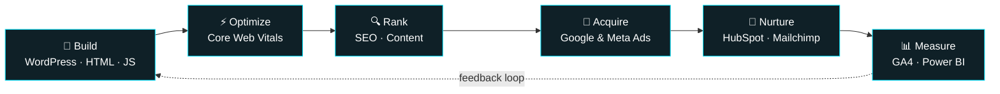

<!-- ⚙️ SETUP: replace every `sanchezstalls` below with your exact GitHub username if it differs. -->

<div align="center">


<a href="https://github.com/sanchezstalls">
  
</a>

<br/>

[](https://sanchezstalls.github.io)
[](https://www.linkedin.com/in/sanchit-shukla)
[](mailto:shuklasanchit20@gmail.com)


</div>

---

## 🧠 `about.json`

```json
{
  "name": "Sanchit Shukla",
  "role": "Web Developer & Performance Marketing Executive",
  "org": "World Robot Olympiad (WRO India) & India STEM Foundation",
  "location": "New Delhi, India 🇮🇳",
  "experience": "3+ years",
  "education": "MCA — IGNOU (2022–2024)",
  "certified": ["Microsoft Azure AZ-900", "Generative AI (Google Cloud)", "AI Essentials & AI Workflow (WsCube Tech)"],
  "focus": ["WordPress Engineering", "Core Web Vitals", "SEO / SEM", "CRM Automation", "Data Analytics"],
  "currentlyLearning": ["AI/ML workflows", "Azure cloud", "Advanced GA4 & Power BI"],
  "lookingFor": "Managerial roles blending creative, technical & analytical expertise",
  "funFact": "I ship websites AND the campaigns that fill them with users ⚡"
}
```

---

## 🚀 Impact at a Glance

<div align="center">

| 🌐 **50K+** | ⏱️ **99%** | 📈 **30%+** | 🎯 **+25%** | ⚡ **50 → 85+** |
|:-:|:-:|:-:|:-:|:-:|
| Users on national robotics platform | Uptime on high-traffic WP sites | Organic traffic growth | Lead-to-enrollment conversion | PageSpeed score lift |

</div>

---

## 🛠️ Tech Arsenal

<div align="center">

### 💻 Languages & Web


### ☁️ Cloud, Data & Design


### 📣 Growth & Marketing Stack


</div>

---

## 💼 Experience Log

```diff
+ 2022 — PRESENT   Web Developer & Performance Marketing Executive
+                  World Robot Olympiad (WRO India) & India STEM Foundation · Gurugram
- 2022 (Mar–Jun)  Front-End Developer Intern · Vsam Networks · New Delhi
- 2021 (May–Nov)  Front-End Developer Intern · ADG Online Solutions · New Delhi
```

<details open>
<summary><b>🏆 WRO India & India STEM Foundation</b> — <i>Nov 2022 → Present</i></summary>
<br/>

- 🏗️ Engineered & maintained high-traffic WordPress platforms — **WROIndia.org** (India's largest robotics competition) and **IndiaSTEMFoundation.org** (national STEM teacher-training initiative) — with **99% uptime** and mobile-first UX
- 📊 Integrated a performance-marketing stack (**Google Ads, Meta, GA4, Search Console**) driving **30%+ organic traffic growth** and optimizing customer acquisition cost
- 🤖 Automated lead nurturing via **HubSpot CRM + Mailchimp**, lifting lead-to-enrollment conversion by **25%**
- ⚡ Optimized **Core Web Vitals (LCP, FID, CLS)** through lazy loading, image compression & caching — **PageSpeed 50 → 85+**
- 🎥 Built SEO-optimized content pipelines for YouTube & blogs, boosting visibility for AI/ML programs like **RoboGenius.com**

</details>

<details>
<summary><b>🔧 Vsam Networks</b> — <i>Mar 2022 → Jun 2022</i></summary>
<br/>

- Built responsive UI components with HTML, CSS, JavaScript & Bootstrap
- Cut page load time by **40%** via asset optimization and a cleaner DOM structure

</details>

<details>
<summary><b>🎨 ADG Online Solutions</b> — <i>May 2021 → Nov 2021</i></summary>
<br/>

- Developed custom WordPress themes & landing pages for education and e-commerce clients (PrepGenius.in, PairIndia.in)
- Implemented on-page SEO + Google Analytics tracking, increasing organic impressions by **35%**

</details>

---

## 🌐 Featured Platforms

<div align="center">

| Project | What it is | Stack / Focus |
|:--|:--|:--|
| 🤖 **WROIndia.org** | National robotics competition platform · 50K+ users | WordPress · Performance · SEO |
| 🎓 **IndiaSTEMFoundation.org** | STEM educator upskilling portal | WordPress · CRM Automation |
| 🧠 **RoboGenius.com** | AI/ML learning academy, campaign-driven enrollment | Google Ads · Meta · Funnels |
| 📚 **PrepGenius** | Test-prep & study-abroad platform | Custom Themes · On-page SEO |
| 🦾 **PairIndia** | Robotics & AI institute website | WordPress · Landing Pages |
| 🏛️ **GemTech PARAS** | GeM portal consultancy for government e-marketplace sellers | Web · Lead Gen |
| 🧼 **Dwipex** | E-commerce cleaning solutions | E-commerce · Conversion |
| 🧾 **CA Nearby Me** | Tax & compliance digital service portal | Web · Local SEO |
| 🏭 **Manufyn** | Global manufacturing sourcing platform | B2B · Automotive & Renewables |

</div>

---

## ⚙️ How I Work — The Growth Engineering Pipeline



---

## 👨‍💻 `sanchit.py`

```python
class SanchitShukla:
    def __init__(self):
        self.role = "Web Developer & Performance Marketing Executive"
        self.location = "New Delhi, India"
        self.stack = {
            "build":   ["WordPress", "HTML5", "CSS3", "JavaScript", "Python", "SQL", "Bootstrap", "Git"],
            "growth":  ["Google Ads", "Meta Ads", "SEO/SEM", "SEMrush", "Search Console"],
            "data":    ["GA4", "Power BI", "Excel"],
            "crm":     ["HubSpot", "Mailchimp", "Email Automation"],
            "cloud":   ["Microsoft Azure (AZ-900)", "Generative AI (Google Cloud)"],
        }

    def philosophy(self):
        return "Fast sites + smart funnels + clean data = compounding growth."

    def open_to(self):
        return ["Managerial roles", "Growth / Performance Marketing", "Web Engineering", "Collaborations"]

if __name__ == "__main__":
    me = SanchitShukla()
    print(me.philosophy())
```

---

## 📊 GitHub Analytics

<div align="center">


</div>

---

## 🐍 Contribution Snake

<div align="center">
  
</div>

<sub>Requires the `snake.yml` workflow (included) — see setup notes.</sub>

---

## 🎓 Education & Certifications

| 🎓 Degree / Cert | 🏫 Institution | 📅 Year |
|:--|:--|:-:|
| **MCA** — Master of Computer Applications | IGNOU, New Delhi | 2022–2024 |
| **BCA** — Bachelor of Computer Applications | IGNOU, New Delhi | 2017–2020 |
| ☁️ **Microsoft Azure Fundamentals (AZ-900)** | Microsoft · DigiSaksham | — |
| 🤖 **Generative AI** | Google Cloud | — |
| 🧠 **AI Essentials & AI Workflow** | WsCube Tech | — |

---

## 🤝 Let's Connect

<div align="center">

I'm open to **managerial, growth and web-engineering opportunities** — if you need a site that loads fast *and* converts, let's talk.

[](https://sanchezstalls.github.io)
[](https://www.linkedin.com/in/sanchit-shukla)
[](mailto:shuklasanchit20@gmail.com)


</div>
